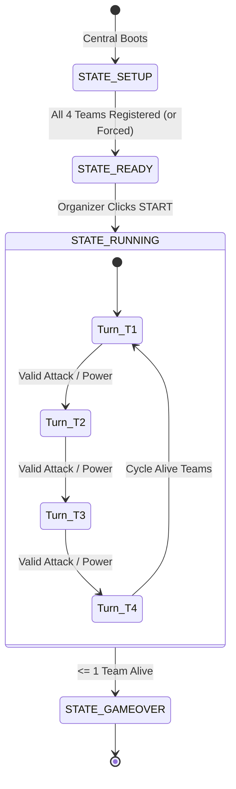

# Meraz Battleship: Official Participant Guide & Combat Manual

Welcome to the **Meraz Battleship Challenge**! Your ESP32 board joins a live four-team naval battle arbitrated in real time by an automated **Central Node** (the referee). Central maintains complete situational awareness: it stores every fleet's secret coordinates, enforces game rules, executes attacks and tactical power-ups, computes scoring, and broadcasts state updates to all terminals and the stadium projector dashboard.

Your mission is to wire your hardware peripherals, configure your fleet and power loadout, and communicate with Central over peer-to-peer **ESP-NOW** wireless packets.

---

## 1. What You Need from the Organizer

| Item | Details |
|---|---|
| **Assigned Team ID** | Number `1`, `2`, `3`, or `4` (selected interactively on screen or Serial on boot) |
| **Team Name** | Up to 20 ASCII characters identifying your squad (e.g. `"TRIcom1"`) |
| **Central Node MAC Address** | 6-byte hardware Wi-Fi MAC address announced at the event (e.g. `6C:C8:40:86:FB:20`) |
| **Wi-Fi Channel** | Channel **`1`** (used by all nodes for ESP-NOW) |

> [!IMPORTANT]
> **MAC Pairing:** You must provide your board's MAC address to the organizer (it prints to the Serial Monitor at boot: `My MAC: XX:XX:XX:XX:XX:XX`). Central automatically filters and pairs with recognized participant MACs; unrecognized hardware is rejected.

---

## 2. The Battle Grid & Fleet Placement

- The battle takes place on a **7 &times; 7 grid**. 
  - `x` is the column: `0` (leftmost) to `6` (rightmost).
  - `y` is the row: `0` (topmost) to `6` (bottommost).
- Each team commands **4 warships totaling 16 HP (cells)**:
  - **Ship 1 (5 cells)**: Straight line (Horizontal, Vertical, Diagonal Down, or Diagonal Up).
  - **Ship 2 (4 cells)**: Straight line (Horizontal, Vertical, Diagonal Down, or Diagonal Up).
  - **Ship 3 (4 cells)**: Straight line (Horizontal, Vertical, Diagonal Down, or Diagonal Up).
  - **Ship 4 (3 cells)**: Straight line (Horizontal, Vertical, Diagonal Down, or Diagonal Up).

### Ship Orientation Reference
| `orientation` Code | Geometry | Coordinate Formula ($i = 0 \dots \text{len}-1$) | Example (from start $x=0, y=0$) |
|:---:|---|---|---|
| `0` | **Horizontal** (Right) | $(x + i, y)$ | $(0,0), (1,0), (2,0)$ |
| `1` | **Vertical** (Down) | $(x, y + i)$ | $(0,0), (0,1), (0,2)$ |
| `2` | **Diagonal Down-Right** (`\`) | $(x + i, y + i)$ | $(0,0), (1,1), (2,2)$ |
| `3` | **Diagonal Up-Right** (`/`) | $(x + i, y - i)$ | Starting $(0,2) \to (0,2), (1,1), (2,0)$ |

### Fleet Layout Rules:
- **Boundary:** Every single cell must fall strictly between coordinates `0` and `6` in both X and Y.
- **No Overlaps:** Ships cannot share coordinates (ships may touch diagonally or side-by-side, but never overlap).
- **Fleet Integrity:** Must contain exactly one 5-cell, two 4-cell, and one 3-cell warship summing to 16 cells.
- **Secrecy:** Your fleet layout is strictly confidential. Only Central knows your ships; opponents only see hits and misses they discover.

---

## 3. Power Armory & Choosing Your Loadout

Before registering with Central, every team customizes its battle capabilities by locking in a **Tactical Power Loadout**.

### Compulsory Moves (Always Available)
| Move | Category | Limits / Cooldown | Summary |
|---|---|---|---|
| **Single Strike** | Attack | **Unlimited** | Standard single-cell artillery shell on 1 opponent. |
| **Energy Shield** | Defence | **Unlimited Uses**<br>*(2-round cooldown)* | Covers a $3 \times 3$ block of your own fleet. Deflects all enemy shells landing within it for 1 round! |

### Optional Attack Powers (Pick EXACTLY 2)
| ID | Power | Uses | Targeting | Tactical Description |
|:---:|---|:---:|---|---|
| **1** | **Sonar Ping** | 2 | Opponent $3 \times 3$ area | Scans a $3 \times 3$ sector on chosen opponent. Central privately tells you how many ship cells are inside. Jammed if target is smoked! |
| **2** | **Salvo Strike** | 2 | Opponent 3 cells in a line | Fires 3 artillery shells simultaneously along a straight row or column. Massive burst damage! |
| **3** | **Sea Mine** | 2 | Own untouched water cell | Arms a secret naval mine. If an enemy fires at that cell, they get a MISS and lose their next turn! |
| **7** | **Double Attack** | 2 | Opponent 2 cells | Fires 2 artillery shells simultaneously at any two distinct coordinates on the same opponent. |

### Optional Defence Powers (Pick EXACTLY 1)
| ID | Power | Uses | Targeting | Tactical Description |
|:---:|---|:---:|---|---|
| **5** | **Smoke Screen** | 2 | Own entire fleet | Shrouds your entire fleet for 1 round. **Deflects ALL incoming attacks and power-ups** (0 damage)! Jams enemy Sonar. |
| **4** | **Emergency Repair** | 2 | Own damaged cell | Restores 1 hit ship cell back to intact health (+1 HP). **Cannot repair completely sunken ships!** |

### The Loadout Byte (Bitmask Format)
The chosen loadout is packed into **one unsigned byte** (`uint8_t`):
$$\text{Bit for Power } P = 1 \ll (P - 1)$$

| Bit | Hex Value | Power Name | Category | Selection Requirement |
|:---:|:---:|---|:---:|:---:|
| Bit 0 | `0x01` | **Sonar Ping** | Attack | Pick 2 from Attack |
| Bit 1 | `0x02` | **Salvo Strike** | Attack | &uarr; |
| Bit 2 | `0x04` | **Sea Mine** | Attack | &uarr; |
| Bit 6 | `0x40` | **Double Attack** | Attack | &uarr; |
| Bit 3 | `0x08` | **Emergency Repair** | Defence | Pick 1 from Defence |
| Bit 4 | `0x10` | **Smoke Screen** | Defence | &uarr; |
| Bit 5 | `0x20` | **Energy Shield** | Defence | Compulsory (Central sets this automatically) |

> [!NOTE]
> **Example Valid Loadouts:**
> - Sonar (`0x01`) + Double (`0x40`) + Smoke (`0x10`) + Shield (`0x20`) = **`0x71`**
> - Salvo (`0x02`) + Mine (`0x04`) + Repair (`0x08`) + Shield (`0x20`) = **`0x2E`**
> - Double (`0x40`) + Salvo (`0x02`) + Smoke (`0x10`) + Shield (`0x20`) = **`0x72`**

Central rejects any registration if the loadout does not contain **exactly 2 attack picks and 1 defence pick**. Once locked in, your loadout is permanent for the match.

---

## 4. Combat Protocol: How to Attack (Single Strike)

Combat in Meraz Battleship is round-based and turn-driven. Central enforces turn order and handles all shot resolutions.

### Step 1: Turn Notification
When your squad's turn arrives:
- The **Green "YOUR TURN" LED** on your board illuminates.
- The piezo buzzer emits an audible ascending alert chirp.
- Your screen displays `>>> YOUR TURN <<<` with the targeting radar unlocked.

### Step 2: Selecting an Opponent & Target Cell
1. **Choose Opponent Tab:** Tap the opponent tab at the top of the tactical radar screen (`T1`, `T2`, `T3`, or `T4`). You cannot target yourself or eliminated squads.
2. **Select Coordinate:** Tap an unattacked cell on that opponent's $7 \times 7$ grid. The cell highlights in yellow with coordinate readouts (e.g. `R3 C4`).
3. **Fire Artillery:** Tap the green **`ATTACK`** button at the bottom of the screen.

### Step 3: Transmission & Central Processing
Your board sends a 4-byte `AttackPacket` over ESP-NOW:
```
[ attacker_id | target_id | x | y ]
```
Central validates:
1. Is the tournament currently running (`STATE_RUNNING`)?
2. Is it genuinely this squad's turn?
3. Is the attacker still alive (not eliminated)?
4. Is the target valid, registered, and still in the match?
5. Has this coordinate already been attacked on this target?

### Step 4: Outcome & Feedback Resolution
Central computes the result and sends an immediate 4-byte `FeedbackPacket`:
```
[ target_id | x | y | result_code ]
```

| Result Code | Constant | Screen Display | Visual / Audio Feedback | Score Effect |
|:---:|---|:---:|---|:---:|
| `0` | **`RESULT_MISS`** | White Dot (`MISS`) | Central announces water splash. Turn ends. | 0 pts |
| `1` | **`RESULT_HIT`** | Red **`X`** with yellow ring | **Red LED flashes**, piezo buzzer victory beeps! | **+10 pts** |
| `7` | **`RESULT_SHIP_SUNK`** | Red **`X`** + Ship Length | Screen announces warship destroyed (Size 3, 4, or 5). | **+15 pts**<br>(+10 hit, +5 sink) |
| `2` | **`RESULT_SUNK`** | Elimination Banner | Target squad's final warship is destroyed; team eliminated! | **+20 pts**<br>(+10 hit, +5 sink, +5 elim) |
| `3` | **`RESULT_MINE`** | White Dot (`MINE`) | Target was empty water armed with a Sea Mine. **Shooter is STUNNED and loses next turn!** | 0 pts |
| `4` | **`RESULT_BLOCKED`** | Blue/Purple **`S`** / Shield | Opponent's **Energy Shield** or **Smoke Screen** deflected shell. 0 damage dealt! | 0 pts |
| `6` | **`RESULT_INVALID`** | `INVALID MOVE` | Attack rejected (e.g., cell already shot). **Turn is NOT lost**; pick another cell and fire! | 0 pts |

---

## 5. Tactical Powers in Full Detail

Every power-up takes your squad's active turn. A rejected power-up request consumes neither your turn nor your power usage.

```
+-------------------------------------------------------------------------+
|                              POWER ARMORY                               |
+-------------------------------------------------------------------------+
|  SONAR PING (x2)       SALVO STRIKE (x2)      DOUBLE ATTACK (x2)        |
|  Scan 3x3 enemy area   3 cells in a line      2 arbitrary cells         |
|                                                                         |
|  SEA MINE (x2)         SMOKE SCREEN (x2)      EMERGENCY REPAIR (x2)     |
|  Trap on own water     Deflect ALL attacks    Fix 1 hit cell (non-sunk) |
|                                                                         |
|  ENERGY SHIELD (Unlimited, 2-round cooldown): 3x3 defensive barrier     |
+-------------------------------------------------------------------------+
```

### 1. Sonar Ping (Power ID: `1`, 2 Uses)
- **Targeting:** Pick any opponent and select the **center cell** $(x_1, y_1)$ of the $3 \times 3$ sweep area (edges clip gracefully).
- **Function:** Central counts the number of intact ship cells inside that $3 \times 3$ perimeter and transmits the exact integer back **privately to only your terminal screen**.
- **Counterplay:** If the target has deployed a **Smoke Screen**, the sonar is **JAMMED** (`PWR_STATUS_JAMMED`). You learn nothing, and the use and turn are spent.

### 2. Salvo Strike (Power ID: `2`, 2 Uses)
- **Targeting:** Select 3 coordinates on the same opponent: $(x_1, y_1)$, $(x_2, y_2)$, $(x_3, y_3)$.
- **Strict Straight-Line Rule:** The 3 cells must form a **consecutive straight line** along a row or column (e.g. `(2,3), (3,3), (4,3)` or `(1,0), (1,1), (1,2)`). Diagonals, bends, and gaps are rejected.
- **Resolution:** All 3 cells must be previously unattacked. Central evaluates each shell sequentially. If cell 1 or 2 eliminates the team, subsequent shells are not fired.

### 3. Sea Mine (Power ID: `3`, 2 Placements)
- **Targeting:** Select one cell $(x_1, y_1)$ on **your own grid**.
- **Rules:** The cell must be **untouched water** (cannot be on a ship cell and cannot be on a cell already shot).
- **Mechanics:** 
  - Only **one mine can be active on the grid at any time**.
  - Its coordinates remain strictly secret (the dashboard logs that you armed a mine, never where).
  - The mine sits dormant until an opponent fires at that cell.
  - When struck, the shell hits empty water (`RESULT_MINE`), the mine detonates, and the attacker is **STUNNED** (skips their next turn).
  - Once your active mine detonates, your second mine placement becomes unlocked.

### 4. Double Attack (Power ID: `7`, 2 Uses)
- **Targeting:** Select any 2 distinct coordinates $(x_1, y_1)$ and $(x_2, y_2)$ on one opponent.
- **Rules:** Both cells must be unattacked. Unlike Salvo, the cells can be anywhere on the target's grid (no straight-line constraint). Central fires both shells at once.

### 5. Smoke Screen (Power ID: `5`, 2 Uses)
- **Targeting:** Requires no coordinates. Deploys across your squad's entire grid.
- **Duration & Deflection:** Active for **1 full round** (from deployment until your next turn arrives).
- **Deflects ALL Attacks:** While active, **every incoming Single Strike, Salvo shell, or Double Attack shell targeting your grid is DEFLECTED (`RESULT_BLOCKED`, 0 damage dealt)!**
- **Radar Display & Expiry:** On the radar, deflected cells show a purple `'S'`. When your next turn begins (1 round elapsed), the smoke expires, and those cells turn back to normal and can be targeted again.
- **Jams Sonar:** Any enemy Sonar Ping sweeping your grid is completely jammed.

### 6. Emergency Repair (Power ID: `4`, 2 Uses)
- **Targeting:** Select one cell $(x_1, y_1)$ on **your own fleet** that has sustained a hit.
- **Mechanics:** Restores that damaged cell back to an intact, operational warship cell (+1 remaining fleet HP).
- **CRITICAL SINK RESTRICTION:**
  > [!CAUTION]
  > **Completely Sunken Ships Cannot Be Repaired!**
  > If an enemy has destroyed **all cells** of a warship (e.g. all 4 cells of Ship 2), that warship is completely sunk. **You CANNOT repair any cell belonging to a completely sunken ship!** Central rejects any such attempt with error code `PWR_FAIL_SHIP_ALREADY_SUNK`. Repair can only be applied to salvage partially damaged warships that are still alive!

### 7. Energy Shield (Power ID: `6`, Unlimited Uses, 2-Round Cooldown)
- **Targeting:** Choose the **center cell** $(x_1, y_1)$ of a $3 \times 3$ block on your own grid ($x_1, y_1$ must both be in range $1 \dots 5$).
- **Effect:** Any enemy shell landing inside that $3 \times 3$ zone is deflected (`RESULT_BLOCKED`, 0 damage dealt).
- **2-Round Cooldown:** Once raised, the shield protects until your next turn arrives. Then the shield drops and enters cooldown: **you cannot raise a Shield on your next 2 turns**. Unlimited total uses per match.

---

## 6. Packet Structures & Wire Protocol

All ESP-NOW communications use raw packed binary structures (`__attribute__((packed))`). Messages are recognized by Central strictly by their **exact byte lengths**.

### Upstream Packets (Participant $\to$ Central)

#### 1. Registration (`RegistrationPacket`, 38 Bytes)
```cpp
typedef struct __attribute__((packed)) {
  uint8_t team_id;              // 1 to 4
  char    team_name[20];        // Null-terminated string (e.g. "TRIcom1")
  ShipPlacement ships[4];       // 4 ships * 4 bytes each = 16 bytes
  uint8_t loadout;              // Loadout bitmask byte (e.g. 0x71)
} RegistrationPacket;
```

#### 2. Single Strike Attack (`AttackPacket`, 4 Bytes)
```cpp
typedef struct __attribute__((packed)) {
  uint8_t attacker_id;          // Your team ID (1..4)
  uint8_t target_id;            // Target opponent ID (1..4)
  uint8_t x;                    // Target column (0..6)
  uint8_t y;                    // Target row (0..6)
} AttackPacket;
```

#### 3. Power-Up Activation (`PowerUpPacket`, 9 Bytes)
```cpp
typedef struct __attribute__((packed)) {
  uint8_t power;                // Power ID (1..7)
  uint8_t team_id;              // Your team ID (1..4)
  uint8_t target_id;            // Target opponent ID (or 0 if targeting self)
  uint8_t x1, y1;               // Coordinate pair 1
  uint8_t x2, y2;               // Coordinate pair 2 (Salvo, Double)
  uint8_t x3, y3;               // Coordinate pair 3 (Salvo)
} PowerUpPacket;
```

---

### Downstream Packets (Central $\to$ Participant)

#### 1. Registration Acknowledgment (`RegAckPacket`, 1 Byte)
```cpp
typedef struct __attribute__((packed)) {
  uint8_t status;               // 0 = OK, 1 = Rejected, 2 = Reconnected, 3 = Reconnect Rejected
} RegAckPacket;
```

#### 2. Combat Feedback (`FeedbackPacket`, 4 Bytes)
```cpp
typedef struct __attribute__((packed)) {
  uint8_t target_id;            // Who was shot (your team or an opponent)
  uint8_t x;                    // Column (0..6)
  uint8_t y;                    // Row (0..6)
  uint8_t result_code;          // RESULT_MISS (0), RESULT_HIT (1), RESULT_SUNK (2),
                                // RESULT_MINE (3), RESULT_BLOCKED (4), RESULT_INVALID (6),
                                // RESULT_SHIP_SUNK (7)
} FeedbackPacket;
```

#### 3. Power Outcome (`PowerResultPacket`, 7 Bytes)
```cpp
typedef struct __attribute__((packed)) {
  uint8_t power;                // Power ID (1..7)
  uint8_t status;               // 0 = OK, 1 = Rejected, 2 = Jammed (Sonar blocked by Smoke)
  uint8_t target_id;            // Target squad
  uint8_t count;                // Sonar only: number of ship cells detected
  uint8_t actual[3];            // Salvo/Double results for each shell (same codes as feedback)
} PowerResultPacket;
```

#### 4. Turn & Round Update (`TurnUpdatePacket`, 2 Bytes)
```cpp
typedef struct __attribute__((packed)) {
  uint8_t current_turn;         // Active squad ID whose turn it is (1..4, or 0)
  uint8_t round_state;          // 0 = SETUP, 1 = READY, 2 = RUNNING, 3 = GAMEOVER
} TurnUpdatePacket;
```

---

## 7. Tournament Match Lifecycle



1. **Phase 0: Registration (STATE_SETUP):** Nodes choose fleet layout and power loadout, then register with Central. Central validates hardware MAC, names, fleet rules, and loadout bytes.
2. **Phase 1: Readiness (STATE_READY):** Central displays all connected teams. When all squads confirm, organizers initiate the battle.
3. **Phase 2: Combat Engagement (STATE_RUNNING):** Turn order rotates through living squads. Teams execute attacks or powers. Eliminated squads are automatically skipped. Stunned squads (from mines) lose their turn and pass it to the next living team.
4. **Phase 3: Victory & Game Over (STATE_GAMEOVER):** When only one squad survives, Central freezes the board, broadcasts `STATE_GAMEOVER`, and crowns the champion!

---

## 8. Official Scoring Matrix

Scores are tracked in real time and displayed on the stadium projector leaderboard:

| Combat Event | Description | Score Points |
|---|---|:---:|
| **Hardware & GUI Build** | Circuit wiring (LEDs, buzzer, display) and verified firmware. | **+20 pts** |
| **Normal Hit (`RESULT_HIT`)** | Damaging an active enemy warship cell. | **+10 pts** |
| **Sinking a Ship (`RESULT_SHIP_SUNK`)** | Destroying all cells of an individual enemy warship. | **+15 pts**<br>(+10 hit, +5 sink) |
| **Eliminating a Team (`RESULT_SUNK`)** | Sinking an enemy squad's final remaining warship. | **+20 pts**<br>(+10 hit, +5 sink, +5 elim) |
| **Last Fleet Standing** | Match survival bonus for being the ultimate victor. | **+30 pts** |
| **Miss / Blocked / Shield** | Shells landing in water or deflected by shields/smoke. | **0 pts** |

---

## 9. Hardware Wiring & Pin Assignments

```
                +----------------------------+
                |        ESP32 BOARD         |
                |                            |
  [GPIO 32] --->|---> [220-330R] ---> [Green LED] ---> GND (Turn Active)
  [GPIO 33] --->|---> [220-330R] ---> [Red LED]   ---> GND (Hit Confirm)
  [GPIO 26] --->|---> [+] [Piezo Buzzer] [-] --------> GND (Audio Alerts)
                |                            |
  [VSPI MOSI] ->|---> SDI (TFT Display)      |
  [VSPI SCK] -->|---> SCK (TFT Clock)        |
  [GPIO 15] --->|---> CS  (TFT & Touch CS)   |
  [GPIO 2]  --->|---> D/C (TFT Command/Data) |
  [GPIO 4]  --->|---> RST (TFT Reset)        |
                +----------------------------+
```

### Virtual Display Simulation (No Physical TFT?):
If testing without a physical touch screen, simply ensure:
```cpp
#define USE_VIRTUAL_DISPLAY
```
is defined near the top of your sketch. Launch [`virtual_display.py`](file:///c:/Users/hemal/OneDrive/Desktop/Battleship/virtual_display.py) on your computer; it provides an interactive TFT touch screen GUI in Python that communicates directly over your ESP32's USB Serial COM port!

---

## 10. Pre-Flight Troubleshooting Checklist

- [ ] **Channel 1:** Is ESP-NOW operating on channel `1`?
- [ ] **Central MAC:** Does `centralMac[6]` in your sketch exactly match Central's broadcasted MAC address?
- [ ] **MAC Submitted:** Has your board's MAC been shared with the organizers?
- [ ] **Packet Sizes:** Check `sizeof()` on your structs: Registration must be **38 bytes**, Attack must be **4 bytes**, Power must be **9 bytes**.
- [ ] **Loadout Rule:** Does your loadout byte contain **exactly 2 attack powers and 1 defence power**?
- [ ] **Repair Rule:** Are you attempting to repair a ship that has already sunk? Remember, **sunken ships cannot be repaired**!
- [ ] **Shield Rule:** Are you attempting to raise a shield on cooldown? Shield has a **2-round cooldown** between uses.
- [ ] **Salvo Straight Line:** Do all 3 cells in your Salvo form a continuous, straight horizontal or vertical line?
- [ ] **Act on Your Turn:** Are you checking `current_turn == MY_TEAM_ID` before transmitting? Moves out of turn are rejected.

*Good luck, commanders, and may the sharpest fleet dominate the seas!*
